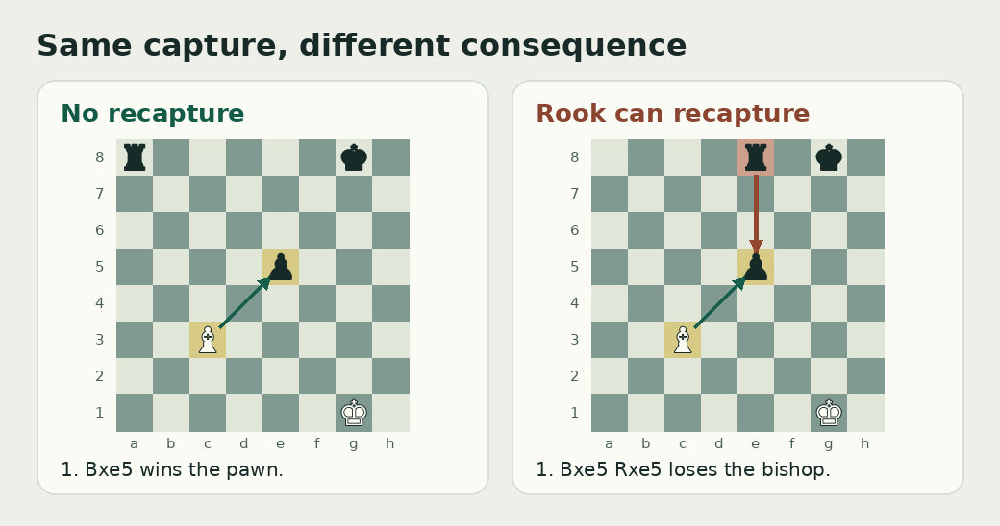

# FlyChess

**Can a model built from a fruit fly’s wiring learn to play chess?**

I’m Ethan Ramli. I play chess, and I wanted to find out what a model built from real brain wiring could learn by making moves and seeing what happens. A published map of a fruit fly’s brain gave me a place to start.

I’d love to play a match against a model that has developed a style of its own. **2000 Elo is my stretch goal.** I started the project to find out what the model can learn and where it hits a limit. [Research motivation](research/project/researcher_vision_2026-10-01.md)

[Current research status](documentation/current-status.md) · [Experiment reports](research/reports/README.md) · [Repository map](#repository-map) · [Run the demo](#run-it-yourself)

<a id="start-here"></a>

<a id="what-flychess-is"></a>

## The FlyChess model

FlyChess is a research project and a chess simulator. It uses a fruit fly’s **connectome**, a map of which neurons connect to which, as the wiring for a computer model. The software shows the model a chess position, reads its activity to score legal moves, and can teach it about the move it chose.

The first lesson is small enough to check exactly. Can the model tell when taking a pawn leaves its bishop open to recapture?



<a id="how-i-test-it"></a>

## Experimental method

1. **Teach a single idea.** The model chooses a move. A separate checker works out the consequence using the rules of chess. During practice, a verified consequence can become feedback.
2. **Find out what did the learning.** Compare the model with versions that get shuffled feedback or have learning disabled. Give simpler systems comparable input and practice to see how much they can explain.
3. **Change the problem.** Keep final test positions out of practice and development. First test whether the model can apply one lesson on unfamiliar boards. Then test whether it can combine lessons that were taught separately.

The [learning plan](documentation/design/research-goals/restart-plan-2026-10-30.md) defines the first test. The [transfer protocol](documentation/design/research-goals/transfer-and-combination-protocol-2026-11-03.md) spells out what would count as passing the later ones.

<a id="repository-tree"></a>

<a id="follow-the-work-in-the-repo"></a>

### Repository map

Start in [`documentation/`](documentation/README.md) to see what a test was meant to measure. Follow the implementation in [`.codebase/`](.codebase/README.md), then read the report and any audit in [`research/`](research/README.md) to see what the test actually showed.

<!-- directory-map -->
| Directory | What lives there and where to start |
| --- | --- |
| [`documentation/`](documentation/README.md) | The [current findings](documentation/current-status.md), [next research decision](documentation/next-checkpoint.md), and [experiment designs](documentation/design/README.md). Go to `design/` for the task, controls, and passing rule. The other folders hold [dated handoffs](documentation/handoffs/README.md), [early ideas](documentation/ideas/README.md), and [plans for turning the research into a paper](documentation/writing/README.md). |
| [`research/`](research/README.md) | [`reports/`](research/reports/README.md) holds experiment outcomes, measurements, and available audits. [`journal/`](research/journal/README.md) records mistakes, fixes, and pivots in date order. [`literature/`](research/literature/README.md) holds source notes and the [five-volume chapter plans](research/literature/writings/README.md). [`project/`](research/project/README.md) holds decisions and permissions. [`outreach/`](research/outreach/README.md) holds expert research and correspondence preparation. |
| [`.codebase/`](.codebase/README.md) | [`src/`](.codebase/src/README.md) holds the fly circuit simulator, chess input, memory rules, move scoring, and browser demo. [`scripts/`](.codebase/scripts/README.md) has the commands that fetch the graph, run experiments, and audit results. [`tests/`](.codebase/tests/README.md) checks the software behavior those commands depend on. |
| [`python actions/`](python%20actions/README.md) | The shared runner handles recurring launch, monitoring, audit and recovery commands. It keeps raw logs on disk and returns short progress updates. Registrations and scripts are grouped by chess data, curriculum, memory and performance. |
| [`archive/`](archive/early-development/README.md) | Work from before the October 30 restart. Browse the [old reports](archive/early-development/research/reports/README.md), [datasets and protocols](archive/early-development/research/data/README.md), or [frozen source copies](archive/early-development/research/source-archives/README.md) to reconstruct an earlier experiment. |
| [`.agents/`](.agents/skills/) | Instructions for AI assistants working on FlyChess, including how to review evidence, write documentation, and divide work. The [project instructions](AGENTS.md) define the research and evidence rules those assistants follow. |
| [`.github/`](.github/) | The [workflow](.github/workflows/readme-navigation.yml) and [checker](.github/scripts/README.md) that catch broken README links and missing folder entries. |
| [`.vscode/`](.vscode/) | The workspace setting that suppresses VS Code’s Git change-limit warning. |
<!-- /directory-map -->

**Follow one experiment.** The [original design](documentation/design/neural-learning/engineered-memory-test-v3.md) for the third engineered-memory test says what it tried to measure. The [run configuration](python%20actions/memory/engineered-memory-test-v3-step.json) records the inputs and identifies the [script that ran the test](.codebase/scripts/neural-learning/run-engineered-memory-test-v3.mjs). The [report](research/reports/engineered-memory-test-v3-2026-11-04/README.md) explains why the test failed. The [journal entry](research/journal/experiments/2026-11-04-memory-v3-run.md) records why the first launch crashed and how the rerun was handled.

For other old versions, start with the [guide to earlier attempts](research/README.md#finding-earlier-versions-and-failures). Some raw logs and checkpoints are machine-local under `runs/`. Use the report to find the recorded paths and any evidence saved in Git.

<a id="the-science--can-the-circuit-keep-a-lesson"></a>

## Learning and memory

The fly’s **mushroom body**, a brain structure involved in learning, motivates the memory experiments. The model tests rules in which a simulated dopamine signal changes selected connection strengths after a choice. To count as useful memory, a change has to affect a later decision and survive further practice. [Learning mechanisms](documentation/design/neural-learning/README.md)

| Experiment | What happened |
| --- | --- |
| [An added memory store](research/reports/engineered-memory-test-v8-2026-11-07/README.md) | It passed an audited test where the choices were restricted to captures. The same store scored higher when it read board features directly than when it used simulated neural activity. |
| [Memory in the model’s own connections](research/reports/fly-connections-memory-v1-2026-11-07/stop-report-2026-11-09.md) | A planned test found connection settings that ranked a safe capture first on one of three boards. It needed two. A more extensive search later found settings for all three. That search awaits independent review, and it remains open whether feedback could teach the model to reach those settings. |

<a id="the-computation--what-runs-on-the-laptop"></a>

## Simulation and move selection

**Board → simulated circuit → move scores.** Code supplies the list of legal moves and turns each candidate board into input. The simulator updates neuron activity along the connections in the wiring map. A separate readout turns that activity into a score for each move.

The teacher checks consequences separately. The project also keeps scores produced by the model alone distinct from scores produced with extra chess search. Looking ahead can improve a move even if the underlying model has learned nothing new. [Code guide](.codebase/README.md) · [Search and feedback](documentation/design/search-and-feedback/README.md)

<a id="the-mathematics--what-fits-and-what-can-work"></a>

## Graph storage and model limits

The graph used here has **134,209 neurons** and **2,700,513 directed connections**. A table with a slot for every possible connection would need far more space:

| Calculation | What it means |
| --- | --- |
| `134,209 × 134,209 = 18,012,055,681` entries | One row for every sender and one column for every receiver. |
| `18,012,055,681 × 4 = 72,048,222,724` bytes | At four bytes per entry, that table alone would take about 72 GB. |

The simulator stores the connections that exist. The calculation measures the size of a hypothetical table. Actual process memory depends on the experiment. [Memory calculation](research/literature/writings/01-methodology/04-memory-estimate-calculation.md)

Math also tells us which repairs to drop. In one saved model state, two earlier lessons required the same scoring setting to be on opposite sides of a gap. One required a value above about 0.08425. The other required a value below about 0.08394. No setting satisfies both, so changing that setting alone cannot repair those saved responses. [Proof and assumptions](research/reports/interference-limits-2026-11-02/README.md)

<a id="the-chess--from-one-tactic-to-a-game"></a>

## Chess concepts and playing strength

The first question is whether the opponent can legally capture back. The later tests add two ideas. A defender may be pinned, and a recapture may still leave you ahead if you took a more valuable piece. The protocol calls for teaching each idea separately before testing whether the model can put them together on a new board.

Playing strength takes a separate test. The [rating plan](documentation/design/evaluation-and-performance/elo-calibration.md) uses full games against a defined pool of opponents under fixed conditions. The [chess volume](research/literature/writings/05-chess/README.md) covers that goal and the kind of player I’d like FlyChess to become.

## FAQ

**Is there a living fly playing?** The player is a simulation. Its wiring comes from a published brain map.

**Does it copy human moves?** Human games can supply positions. In the main research plan, feedback comes from the consequence of the model’s own choice. Supervised baselines are recorded separately.

**Does Stockfish pick the moves?** The local demo picks moves using the untrained FlyChess model. A separate checker verifies move consequences. The future rating plan uses Stockfish as a reference opponent.

**Has FlyChess shown reasoning yet?** That result is still open. The [current status](documentation/current-status.md) explains what has been tested and what remains.

## Run it yourself

Install Git and **Node.js 22 or newer**, then run:

```sh
git clone https://github.com/ethanramli/fly-chess-research.git
cd fly-chess-research
npm ci
npm run fetch:graph
npm run play
```

Open the address printed in the terminal, usually `http://127.0.0.1:4173`. You’ll play against an **untrained** model that evaluates one move ahead. Run `npm test` to check the software. For reproducing research runs, start with the [experiment handoff](documentation/next-checkpoint.md) and [contributor instructions](AGENTS.md).
