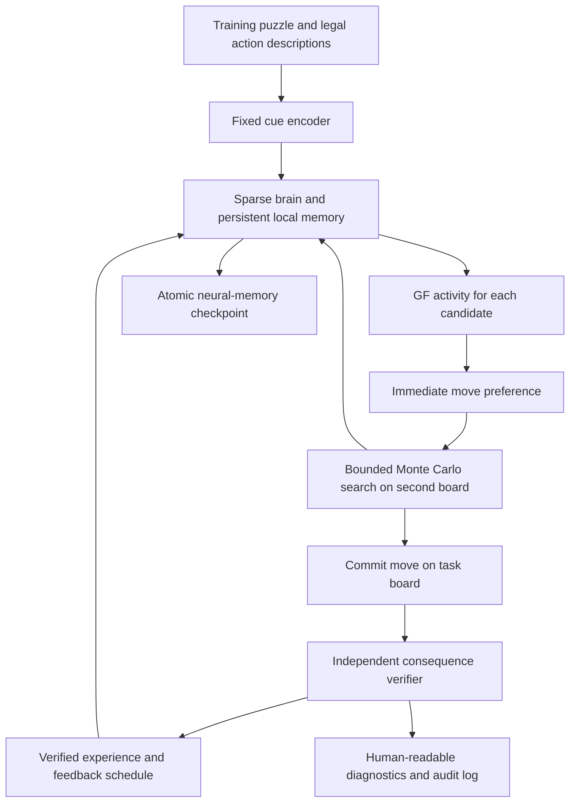

# Puzzle-learning system design: neural choice and bounded investigation

Date: 2026-10-05 (Asia/Jakarta). Status: **system design; learning mechanism and neural interfaces are candidate experiments, not a working chess learner.**

## What Ethan is asking us to build

The model starts from scratch, makes choices, investigates consequences through bounded Monte Carlo search, receives independently checked feedback, and retains changes that improve its first choices and subsequent investigation on unfamiliar positions. The giant-fiber (GF) circuit is intended to be central to the immediate choice process. Progress should depend on the usefulness of experience, not merely elapsed turns, puzzle repetitions or parameter count. Human-game move imitation is excluded from the main condition.

In ordinary language: show a position; let the model consider actions; let it investigate; show it what actually follows from its decisions; test whether its next first impression is better. The teacher must not secretly make that first impression good by supplying the answer before the choice.

This design covers the full requested system. It separates buildable task software from the biological hypotheses that must pass experiments. No design can guarantee reasoning, reliable learning or Capablanca-level play in advance. The requested design deliverable is complete when the interfaces, mechanisms to investigate, resource bounds, implementation dependencies and tests are specified; those tests passing is a later experimental outcome.

## 1. Authoritative starting point

Inspected source: `puzzle-round.mjs`, `puzzle-search.mjs`, `positions.mjs`, `trainer.mjs`, `mushroom-body.mjs`, and the association protocols. The existing PUCT runner separates a hypothetical board from the task board and independently verifies a bounded mate objective. Its feedback receiver only records events. It has no trained move policy or neural reinforcement delivery. The current position encoder does not carry repetition history, although search copies preserve it. The current kernel restarts activity for every forward call.

The gamma4 prototype has individual efficacy gains on selected existing KC-to-MBON connections. A single activity value per neuron does **not** imply a single memory value per neuron. However, subcellular physiology, natural reward delivery and reliable contingency reversal remain absent. V1 and V2 failed their complete gates; V2 strengthened acquisition preferences in 6/6 seeds and selected the reversed target in 3/6. These results remain unchanged.

Read-only audit: [raw anatomy report](../../../archive/early-development/research/reports/instinct-design-2026-10-05/anatomy-with-relay.json). Both annotated GF cells occur in the pinned 134,209-neuron, 2,700,513-directed-edge graph:

| Cell | Root ID | Index in this graph | LC4 incoming edges | LPLC2 incoming edges |
|---|---|---:|---:|---:|
| Right GF / DNp01 | `720575940632499757` | 105374 | 49 | 62 |
| Left GF / DNp01 | `720575940622838154` | 55463 | 40 | 37 |

No annotated MBON directly inputs to either GF in this released graph. All 96 annotated MBONs have a directed path to at least one GF within four edges: 7 at two edges, 73 at three, 16 at four. This broad reachability is weak evidence for functional specificity. It establishes feasibility of perturbation experiments, not a dedicated memory-to-instinct pathway. The full graph, including competing paths, must be used; selecting one attractive path would distort the experiment.

The audit also finds MBON12 (4 cells), PPL103 (2), PAM02 (12), MBON01 (2), and two positive-sign MBON12-to-PAM02 edges. Ontology aliases match the cell types in the candidate punishment-omission relay discussed below. Cell-type presence does not resolve exact compartment membership or the required physiological dynamics. The audit counts all annotated KC inputs; the existing gamma4 mapping is a narrower hemisphere/subtype subset, so its 1,056 edges must not be confused with the audit's all-KC counts.

## 2. Architecture and information boundary

The teacher owns puzzle objectives, verification and a bounded schedule of experiences. It has no access to writable model arrays and returns no gradients, weight deltas, target move distribution, or optimized head. The brain receives specified stimulation events. Its registered local mechanism determines persistent changes. The searcher uses the brain and chess rules but cannot query the teacher's answer or proof cache. The evaluator uses frozen memory and never supplies reinforcement.

Software boundaries should be enforced by separate interfaces and immutable arguments, even in one serial process. A single process avoids duplicating the graph; separation here is access discipline, not a security claim.

| Component | Inputs | Outputs | Forbidden shortcut |
|---|---|---|---|
| Cue encoder | Current public board, legal candidate, task mode, available history | Bounded sparse stimulation | Puzzle answer, engine value, motif label, future proof |
| Brain probe | Cue, frozen memory snapshot | GF signals and resource counters | Teacher assessment or plasticity during search |
| Search | Legal rules and brain responses | Choice, visited lines, estimates, stop reasons | Treating visits or rollout wins as certified feedback |
| Verifier | Committed choice, task/history, proof budget | Evidence with scope and unknown status | Reporting sampled weak defense as best defense |
| Experience scheduler | Verified evidence, completed trial | Cue/outcome presentations and biological-time schedule | Computing parameter changes |
| Brain learning step | Presented cue and specified neural reinforcement | Local traces/gains, delivery receipt | Global optimizer or changing fixed wiring |

## 3. The proposed GF role is an action-specific alarm

The candidate main condition reads only the two identified GF cells to rank moves. No learned output head bypasses them. It serially presents the **current board plus one candidate action**. The selected action has the lowest measured danger response; bounded search uses these same responses to allocate investigation. This makes GF central to the proposed fast-choice interface, rather than merely lighting it up after the external chess engine has decided.

This is an engineered interpretation of escape output, not a known biological chess code. GF evidence concerns rapid escape triggered by visual features [S1]; it does not establish a general reasoning centre. GF habituation [S2] is a separate possible effect, not proof of action-specific avoidance learning.

Proposed readout, fixed before chess training:

1. Measure each GF's resting activity `r0` and response `r1` to a predefined, label-free LC4/LPLC2 stimulation panel. Use actual mapped neurons. If the response has the wrong direction or negligible dynamic range, this interface fails rather than changing graph signs to make it work.
2. For a candidate, calculate each GF's normalized response `(r-r0)/(r1-r0)` and take the maximum across the pair. Retain raw, unclipped responses for diagnosis; clip the danger index to `[0,1]` for the decoder. This index is not a probability of losing.
3. Rank legal candidates by increasing danger; break exact ties using a seeded, outcome-independent order. PUCT priors are `0.85 * softmax(-4 * danger) + 0.15 / legal_count`. These constants are engineering proposals, not fitted biology; freeze them before the experiment and compare a uniform-prior control.

The first-choice measurement means a serial sweep of legal candidate descriptions **with no future-board exploration**. It is not a single neuron evaluation or a promised human-like millisecond reaction. Root coverage and pulse count must be reported. Probing candidate actions must not modify persistent memory or accumulate reinforcement eligibility.

GF clamping will trivially remove a GF-only decoder's information. That ablation alone cannot establish a biological role. Require candidate-specific changes at GF, memory reset/restoration, perturbation of the proposed upstream plastic sites, and a matched alternative readout. If another readout learns but GF does not, report failure of the requested GF hypothesis; do not silently substitute that architecture.

## 4. What the brain is shown

Use a fixed, sparse encoder with no pretrained or trainable translator. Encode piece identity, colour, square, side to move, castling rights, legal en-passant state, the candidate's origin/destination/promotion, and the declared task. Include halfmove and repetition context from the task history; a FEN-only row cannot support a history-sensitive claim. For pawn direction and castling, use only legal, explicitly verified transformations.

The first interface candidate is **direct experimental KC stimulation**. A seeded feature-hash projection maps feature tokens to a fixed KC pool. Bound the number of stimulated cells and total current per presentation; explicitly encode board-action conjunctions so the same destination in different positions need not be identical. Hash collisions and cue overlap must be reported. Fixed projection is an engineering sensory substitute; it does not establish natural vision, odor processing or biological action encoding.

Freeze the encoder seed, target pool, current limits, collision policy and feature inventory before each protocol. The final KC pool depends on the compartment audit in Gate A. It cannot be an arbitrary convenient set of graph indices. Do not create one independent random cue per puzzle ID: that would invite lookup-like memorization. Do not compute a fork detector, engine score or blunder flag inside the main encoder. A relational-feature encoder may be a separately labelled comparison because it supplies additional chess knowledge.

No category such as "fork" has a dedicated invented dopamine neuron. Rich feedback primarily consists of **the actual verified situation and consequence**, including counterexamples, rather than extra semantic labels injected into an alarm cell.

## 5. What can learn, and the candidate biological mechanism

For the current candidate, keep root identities, topology, anatomical counts, fixed signs, nonplastic magnitudes, biases, leaks, encoder, readout calibration and search constants immutable during learning. The researcher's whole-model adaptation ambition remains unsatisfied by its 870 eligible edges. Testing the whole decision process for transfer does not replace that coverage requirement. A broader model may permit more persistent physiological state to adapt if each mechanism is justified while preserving wiring/sign invariants. Which additional states can change and how feedback reaches them remain unresolved; arbitrary global weight optimization would not answer those biological questions. This clarification was added on 2026-10-05 rather than redefining the requested scope around the current prototype.

Candidate persistent state is compartment-specific efficacy at eligible existing KC-to-MBON connections. Eligibility and neuromodulatory traces are transient local state. A connection's effective magnitude is its pinned anatomical initialization times a bounded, nonnegative gain. No new connection or sign flip is permitted. Any receptor-specific or subcellular state added later must have an evidence and memory-budget entry.

**Mechanism candidate M1: an aversive association plus a separately supported safety/omission pathway.** Hige et al. provide evidence for cue-specific KC-to-MBON depression following appropriately timed dopamine activation [S3]. McCurdy et al. identify a PPL1-gamma2alpha'1 / MBON-gamma2alpha'1 / PAM-beta'2a / MBON-gamma5beta'2a relay involved in aversive reversal [S4]. In the local ontology these correspond to PPL103, MBON12, PAM02 and MBON01. Felsenberg et al. support coexisting opposing traces during extinction [S5]. These results motivate a richer candidate than repeatedly depressing the same gamma4 connection.

Proposed experiment: present a selected cue, deliver a fixed aversive stimulation schedule to mapped PPL103 cells after a verified adverse outcome, and allow the existing MBON/DAN network to evolve under an explicit local plasticity model. During omission trials, remove that aversive stimulus; do **not** replace omission with an externally calculated negative update or manually force a PAM reward. Test whether the implemented relay produces the predicted PAM and MBON changes. A "safe" cue is an actual completed nonpunished experience, never a verifier timeout.

**This is a candidate experiment, not a finalized equation or validated mapping.** The graph's cell-level connections do not locate all synapses within gamma2, alpha'1 or beta'2a, and dopamine modulation is not equivalent to an ordinary signed graph edge. The necessary compartment masks, receptor model, recovery dynamics, measured time course and strength of the MB-to-GF effect remain to be established. Only a source-derived mechanism card that passes Gate A/B can enable `learn`; otherwise this system runs in explicitly record-only mode.

The mechanism card must contain: exact root IDs and compartment eligibility; reward-stimulus targets; local state variables and units; complete update equations with numerical integration; parameter provenance and bounds; omission, repeated-pulse, timing-order and delay predictions; permitted changes; checkpoint fields; and the independent biological observations used for evaluation. Fit any numerical approximation to biological development data, not chess success or failed V1/V2 gates. Reserve independent biological conditions for validation. A successful numerical fit is still a model, not a measured mechanism in this simulated fly.

The existing gamma4 timing rule remains a frozen engineering comparison. A published mechanistic extinction model [S7] provides another comparison, but its dense miniature architecture and modelled feedback connections cannot be transplanted into this graph or described as experimentally established biology. GF habituation is an alternative upstream mechanism to investigate if the MB route fails, not an automatic replacement: habituation alone can reduce alarms indiscriminately.

## 6. Bounded Monte Carlo investigation on this laptop

Use one sparse brain instance and one hypothetical chess board at a time. Maintain a fixed-size tree in typed arrays. Never keep a brain activation tape per node, clone the graph per simulation, allocate an edge-by-batch tensor, or introduce worker processes.

The search controller performs PUCT selection, applies legal hypothetical moves, queries the frozen GF policy, and backs up search estimates from the appropriate side to move. Opponent nodes use the opponent's perspective and the same budget. A uniform exploration floor ensures low-prior refutations can be visited. Visits, neural danger and proof status are separate fields.

Use bounded stochastic rollouts guided by the GF priors; their endpoints are scored by terminal chess rules. Unresolved nonterminal leaves carry a neutral **search estimate**, with an explicit unknown marker. Do not convert the danger index into a calibrated game value or use the independent teacher's labels as leaf values. A separately trained value interface is a later, separately justified extension, not an assumed capability of the two GF cells.

Proposed laptop profile (engineering limits, not a measured new-system throughput result):

| Resource | Limit | On exhaustion |
|---|---:|---|
| Root legal candidates | 256, serial; all must be scored for a full first-choice result | Mark coverage incomplete and defer the trial; do not claim full choice quality |
| Brain forward pulses, total | 512 per episode, including probes, search, replay and feedback | Stop before next pulse; keep its intended use in the counter |
| Search simulations | 128 | Select from completed statistics if root is complete |
| Combined tree node/edge slots | 4,096 | Stop expansion; record capacity cutoff |
| Hypothetical depth | 8 plies | Mark unresolved leaf |
| Search elapsed | 60 seconds, including pacing | Stop between evaluations; record overshoot |
| Independent verifier | 50,000 nodes, 8 plies, 15 seconds | Unknown for unfinished claims |
| Reviewed experiences | At most 4 selected cues, at most 8 neural presentations total | Leave additional evidence in log; no silent extra training |
| Episode elapsed | 120 seconds, including verification, review and pacing | Finish/abort at recoverable boundary |
| Resident-memory target | 300 MiB process RSS | Report target miss; do not claim laptop profile passed |
| Soft safety guard | 768 MiB RSS; at least 256 MiB free system memory | Stop and resume from last complete checkpoint |
| CPU duty | 0.5, one process | Compute/rest schedule; no hard OS cap |

Reserve the review/feedback pulse allowance before search; search cannot consume the learning phase's entire pulse budget. Wall-clock budget also reserves a bounded review interval. A long in-progress evaluation is not interruptible; these are soft deadlines. An episode that cannot complete the root sweep within its cap records no full-root first-choice result and receives no fabricated failure feedback. The fixture curriculum can start with smaller legal sets; later profiles may increase time/evaluation limits without increasing resident tree size. Every such change is versioned and compared under matched budgets.

A tree slot can use 64 bytes: parent/child/sibling indices, packed move, visits, flags, prior, accumulated score and hash fields. At 4,096 slots this is 0.25 MiB. Hashes only accelerate lookup; exact board/history identity must resolve collisions. Store board state by reconstructing from root and the bounded move stack, not by retaining FEN strings for every node. Keep a separate bounded verifier stack; it cannot pollute the tree or neural policy.

Planning budget: reserve up to 180 MiB for graph, model and load-time transients; 24 MiB for added gains/traces/recovery buffers; 16 MiB for task/search/proof/stream buffers; 80 MiB for runtime overhead and margin. Sum: 300 MiB. These are allocation envelopes requiring measurement, not empirical usage or a guarantee. At 1.5 million eligible edges, four Float32 fields cost about 22.9 MiB; if the justified mechanism needs more state, revise the budget explicitly rather than silently omitting biology.

Keep the existing inference kernel first. A later two-buffer inference path could reduce tapes, but must be verified against the current recurrence and measured; no improvement is claimed here. Do not load Adam states in the biological condition. Run commands with `node --max-old-space-size=256` and `--cpu-duty 0.5`.

Fresh evidence: the existing record-only fixture used **101.01 MiB peak RSS**, 2.110 seconds through reporting preparation and 1.594 CPU seconds. The anatomy audit used **138.94 MiB peak RSS**. These are different workloads, not performance comparisons or measurements of M1. [Measurement note and exact commands](../../../archive/early-development/research/reports/instinct-design-2026-10-05/anatomy-with-relay.json).

## 7. High-quality feedback means evidence, specificity and a useful next experience

The teacher emits a structured evidence record; this is not itself a neural reward. Each claim includes actor colour, full starting history, chosen action, objective, proof method/version, node/depth/time budget, status, and a replayable witness or counterexample certificate. The teacher may additionally identify candidate omission, evaluation error, missed defense or depth cutoff. These are human diagnostics, not fabricated neural concepts.

Verifier tiers:

1. Exact chess legality and terminal outcome, with rule/history tests.
2. Exhaustive bounded AND/OR proof: for "can force mate within H", success needs an attacking strategy against every defense; one principal variation is insufficient. Failure is restricted to that horizon, not proof of losing chess. Certificate checking reruns all required branches from recorded inputs.
3. Bounded material/exchange or other rubric claims with declared assumptions. An immediate capture does not prove an uncompensated blunder. An unsettled sacrifice or compensation question remains unknown outside the verified scope.
4. Optional independently budgeted engine/reference evidence, distinctly labelled estimated unless it supplies an exact certificate. Agreement of two engines is not a theorem. The main learning condition does not copy their suggested moves.

A poor move is punished only for an established task-relative consequence. To call it an avoidable blunder, also establish that an alternative could avoid that consequence. Otherwise the model could be punished for an already lost position. If several criteria conflict, retain each result and its uncertainty; resolve only through a preregistered task priority, such as terminal loss before material. Never flatten unknown evidence into a negative scalar.

Example: the model rejects a sacrifice, and independent verification finds a forced mate. The teacher can present the model's failed line and a verified counterfactual line **after commitment**. This is teacher-provided experience and must be counted as such. Its root cause can be diagnosed only if evidence distinguishes omitted candidate, misvaluation, unsearched refutation or insufficient depth; otherwise use `undetermined`. A prose explanation generated after the fact is not evidence of the brain's reasoning.

The main stimulus alphabet is intentionally small: cue presentation, identified aversive stimulation, identified appetitive stimulation where separately validated, and outcome-known omission. Unknown means **no learning trial**, including no implicit omission trial. Reset transient trial state to its saved pre-review snapshot after an aborted/unknown presentation; log this as an experimental trial-control operation. A verified outcome maps to a predeclared stimulus schedule, never a teacher-calculated weight change or an arbitrary negative dopamine level. Fixed pulse strength first; severity-dependent schedules require their own validation.

## 8. Credit assignment without pretending search is biological imagination

Freeze all persistent learning state during candidate evaluation and hypothetical search. The search tree is an external computational aid. Visiting a position does not prove that the brain internally imagined it, and a sampled win does not reinforce it.

After commitment, deliver feedback to the selected state-action presentation within the mechanism's supported simulated-time window. CPU calculation and sleep do not advance biological time unless explicitly specified. This is a discrete experimental timing convention, not a claim that a live fly waits motionless while a verifier runs.

For consequences beyond a supported trace interval, use a bounded **teacher replay**: re-present the selected board-action cue, then its verified outcome stimulus with the validated timing. State-action association is the thing being tested; the cue carries action identity and its board context. This avoids distributing one outcome over every visited branch or extending traces arbitrarily to fit a chess combination. Replay is an additional training exposure, not endogenous recollection or an imitation target.

For a sequence, keep at most eight committed state-action records. Reinforce a particular earlier choice only when its task-relative consequence is independently certified. Otherwise retain a sequence-level result and withhold unsupported per-step credit. Counterfactual and intermediate-line experiences are separately tagged. A sacrifice with delayed benefit must not be punished merely for a temporary material dip. Spontaneous replay, long biological working memory and internally learned search allocation remain later hypotheses requiring their own mechanisms.

## 9. Curriculum and evaluation measure useful learning per experience

Use authored/generated legal puzzle families and audited puzzle positions without human move demonstrations in the main condition. Do not call puzzles a reasoning test merely because they are puzzles. Group by source lineage, transformation family, tactical structure and near-duplicate relationship before splitting. Put all related variants in one split. Train, development/validation and frozen final-test manifests are separate and hashed; no final-test file is accessible to curriculum selection.

A proposed experience cycle is independent attempt, verified diagnostic review, a changed training position, then delayed revisit after other experiences. Immediate corrected retries measure repair. Train-only counters identify weak families. Allocate a fixed exploration share to less-seen training families so the curriculum cannot become a lookup loop around recent failures. Version any adaptive sampling rule before use; do not use validation or test errors to select individual training puzzles.

Progress measures, all reported separately:

- First-choice verified mistake rate on novel positions, without search or teacher feedback.
- Success under a fixed neural-evaluation and search budget, with candidate coverage and unknown rates.
- Quality against verified defensive replies; performance on sacrifices, intermediate moves and new combinations of familiar motifs.
- Counterfactual sensitivity: preserve irrelevant details but alter a defender or tactical relationship, and verify whether the correct preference changes.
- Verified improvement per 100 informative experiences, per brain pulse and per CPU hour. Include teacher verification/replay costs, unknown trials and repetitions in the accounting. Parameter count and turns are not learning-progress metrics.
- Acquisition, delayed response persistence, reversal, safe-action discrimination and false-alarm rate. A model that fears every action fails even if it avoids some blunders.

Freeze the checkpoint-selection rule using validation only. Proposed rule: select the earliest checkpoint meeting every declared validation floor; break ties by fewer neural pulses, then lower CPU cost. If none passes, select none. Validation floors, meaningful effect sizes and sample counts must be preregistered after a feasibility pilot that uses separate development families. Report family-clustered uncertainty rather than pretending correlated positions are independent. Evaluate final test only after one frozen selection. Test results cannot tune the next checkpoint; a new study needs new held-out families.

Required matched controls: naive memory, no informative feedback, pulse-count-matched shuffled feedback, disabled plasticity, memory reset/restoration, GF output clamping, upstream plastic-site perturbation, and the same search with uniform priors. Compare scalar outcome-only feedback to the reviewed-experience condition at matched exposure and compute budgets to test whether higher-quality feedback improves sample efficiency. A supervised imitation condition is optional and explicitly separate. Neither high solve rate from search alone nor a change in neuron activity establishes transferable learning.

## 10. Persistence and audit contract

Publish an atomic checkpoint at each completed learning presentation and each completed episode. It contains graph/annotation/ontology/source/encoder/mechanism/protocol/dataset hashes; RNG states for choice, search, curriculum and replay; dataset cursor; exact task/history; current biological time; local gains/traces; completed event IDs; selected/committed action; pending review schedule; invariant hashes; resource counters; and certificate identifiers. The graph is referenced by hash, not duplicated per checkpoint.

Write to a new partial directory, verify array sizes and checksums, then rename. Keep the previous completed checkpoint. A partial directory is not resumable. Resume to a new output directory and reject changed mapping, seed, protocol or inputs. Never redeliver a completed pulse. Search can restart from its saved pre-search RNG/state after interruption, because it is read-only; record duplicated compute cost. If learning has started, resume at the last completed neural event. Serialize streams in bounded chunks to avoid a second full copy of persistent arrays.

Receipts distinguish `feedbackVerified`, `stimulusDelivered`, `neuralResponseObserved`, `persistentStateChanged`, and `transferTestPassed`. None implies the next. Record-only mode must retain `appliedToNeurons: false` and `learningApplied: false`. Biological mode lists the exact changed arrays/edges and verifies every fixed-state invariant.

## 11. Implementation sequence and rejection gates

| Gate | Work and evidence required | Pass enables | Failure means |
|---|---|---|---|
| A: identity and mechanism | Exact compartment masks, physiological mechanism card, mapped stimulus targets, sign limitations, existing routes; independently validated numerical dynamics | An isolated learning experiment | Keep chess feedback record-only; do not invent missing connections |
| B: GF response and learning | Cue-dependent GF effect, matched informative/absent/shuffled controls, memory causality, acquisition, retention interpretation, reversal and safe cues; independent biological predictions | GF-driven neural choice interface | GF-centred hypothesis unsupported; preserve failures |
| C: task correctness | Both actor colours, mate-horizon semantics, sacrifice/unknown handling, repetition, all-defense certificates, cue/teacher separation, no learning in search | Bounded puzzle training | Fix task pipeline before interpreting choices |
| D: one learning round | Verified stimulus and permitted memory change, later unaided choice change versus matched controls, exact resume, RSS envelope | A working puzzle-and-feedback learning milestone | Recorded success/search alone is insufficient |
| E: transfer and feedback value | Frozen family-held-out and counterfactual tests, fixed budgets, per-criterion results, feedback-quality comparison, GF and search ablations | A scoped scientific learning claim | No reasoning, strength or sample-efficiency claim |
| F: optimize then scale | Matched time-to-quality and memory evidence, unchanged frozen scientific tests | Larger curriculum/profile | No speedup from different workloads |

Gate B requires a new frozen specification with new development seeds; it cannot redefine V1/V2 acceptance. Reversal must produce the correct new choice and preserve matched controls, not merely move the response margin in the desired direction. Numerical/software persistence is not measured biological retention. Avoid using the final chess test to choose which biological mechanism to pursue.

Proposed implementation boundaries: `instinct-interface.mjs` (fixed cues and GF readout), `learning-mechanism.mjs` (registered local mechanism), `experience-teacher.mjs` (certificates and stimuli), extensions to `puzzle-search.mjs` (typed tree and granular pulse accounting), and `train-experience.mjs` (serial driver/checkpoints). These modules do not exist yet. Reuse the graph loader and the real/task-board separation; keep old experiment paths reproducible. Do not advertise a runnable training command before these modules and their gates exist.

## 12. Design coverage and unresolved facts

2026-10-05 implementation evidence: a [frozen read-only relay probe](../../../archive/early-development/research/reports/relay-probe-2026-10-05/README.md) now measures mapped cell responses and exact checkpoint replay while preserving every parameter. A [mechanism evidence card](../neural-learning/reversal-mechanism.md) records source/mapping gaps. This is Gate A investigation; it does not pass the learning or GF-choice gates.

Later 2026-10-05 GF replay: [stored-memory probes](../diagnostics/gf-readout-probe.md) now reproduce all original MBON responses and measure causal downstream GF changes. The unclipped diagnostic decoder makes correct acquisition/reversal choices in 6/6 informative seeds, but all tested cue responses are below rest; the application clipping specified in section 3 erases them into ties. This preserves a failed application-interface prediction. Reused synthetic cues, coarse masks and a diagnostic decoder do not pass Gate B, and no puzzle feedback is connected. Do not choose a new offset/gain from these outcomes and call the original interface validated.

Further 2026-10-05 implementation: [chess-cue input and a new label-blind input-range calibration](../chess-input/board-action-cues.md) now exist in `chess-cue.mjs` and `gf-readout.mjs`. A frozen naive panel yields distinct responses for all actions within each position while preserving graph/parameter identity. This addresses the board/action input boundary and tests numerical calibration, not the independent learning or biology gates. The larger `instinct-interface.mjs`, learning/teacher driver and search integration listed above remain unimplemented; the historical module-status statement describes the original design. Calibration uses development inputs only and must stay frozen before conditioning; original clipping failures remain preserved.

Later 2026-10-05 choice experiment: [new encoder-seed association with overlapping board/action cues](../chess-input/board-action-association.md) now tests the frozen clipped calibration and source-derived candidate under four controls. It fails overall: acquisition/reversal correct only 3/6 and no informative choice changes from baseline, despite positive reversal margins above controls and exact memory causality. All 384 local updates audit correctly. Unclipped GF diagnostics remain 3/6; MBON diagnostics cannot be substituted into the requested GF condition. Gate B remains unpassed, and the verified puzzle receiver remains record-only. These are experimental aversive labels, not chess consequences.

The request for a design is addressed by the architecture, proposed GF-only choice interface, concrete teacher/search boundaries, experience and credit contracts, laptop budget, validation sequence and authoritative anatomy audit. The key unresolved scientific fact is whether a justified local mechanism can make GF responses represent candidate-specific learned danger with useful transfer. That must be tested, not filled in with an arbitrary update rule. Exact compartment masks and numerical physiology remain Gate A deliverables; their absence prevents claiming that this is already an executable, biologically validated learner.

No public deployment, email, manuscript submission, new dependency or modification of the existing learning equations is part of this design change.

## Sources and provenance

Sources accessed 2026-10-05. Experimental results, computational proposals and project measurements have different evidential status. The targeted search was not a systematic review; see [search record](../../../research/literature/source-solution-register.md).

- **S1 — Ache et al., 2019**, [GF looming inputs](https://pubmed.ncbi.nlm.nih.gov/30827912/). Experimental LC4/LPLC2-to-GF feature integration and escape; no chess or associative danger-learning result.
- **S2 — Engel and Wu, 1996**, [escape-circuit habituation](https://pubmed.ncbi.nlm.nih.gov/8627381/). Plasticity upstream of GF; repeated stimulation can attenuate response.
- **S3 — Hige et al., 2015**, [cue-specific KC-to-MBON plasticity](https://pubmed.ncbi.nlm.nih.gov/26637800/). Supports local, timed association; not a complete equation for this model.
- **S4 — McCurdy et al., 2021**, [punishment omission and reversal](https://www.nature.com/articles/s41467-021-21388-w). Experimental candidate relay, not a verified route to GF in this simulation.
- **S5 — Felsenberg et al., 2018**, [parallel opposing extinction memories](https://pmc.ncbi.nlm.nih.gov/articles/PMC6198041/). Supports separate traces; does not authorize generic negative updates.
- **S6 — Handler et al., 2019**, [timing-dependent associations](https://pmc.ncbi.nlm.nih.gov/articles/PMC9012144/), and **Aso and Rubin, 2016**, [cell-type-specific learning rules](https://pmc.ncbi.nlm.nih.gov/articles/PMC4987137/). Timing differs by circuit; no universal chess-length eligibility window follows.
- **S7 — Springer and Nawrot, 2021**, [mechanistic extinction model](https://pmc.ncbi.nlm.nih.gov/articles/PMC8211469/). Computational comparison only; its miniature architecture cannot replace released wiring.
- **S8 — Phelan et al., 2008**, [GF electrical synapses](https://www.cell.com/current-biology/fulltext/S0960-9822(08)01536-4). Missing electrical/motor dynamics limit physiological claims from the current signed rate graph.
- **S9 — Felsenberg et al., 2017**, [reward-memory re-evaluation](https://www.nature.com/articles/nature21716). Reward omission and aversive extinction have different experimentally supported routes; not interchangeable scalar signs.

The anatomy report binds the exact local graph, pinned FlyWire table and FlyBase ontology by SHA-256. It verifies source immutability and reconstructed directed paths. Root-ID joins use strings from BigInt64 arrays. Neither ontology names nor shortest paths establish receptor distributions, release dynamics or functional learning.
