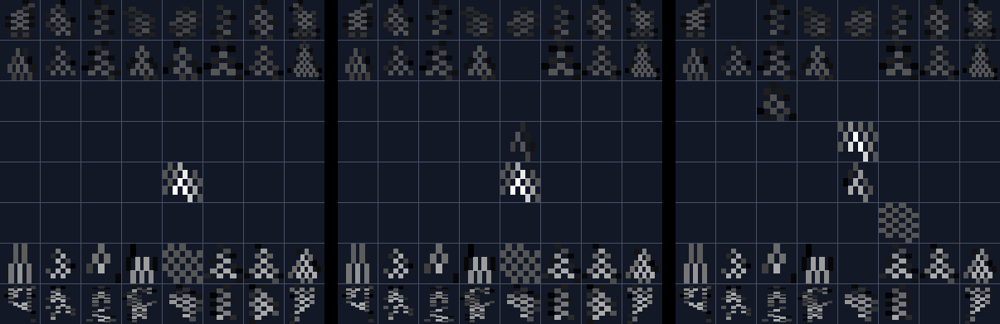

# Eyes v1 static check, 2026-10-31

Static checks of the frozen renderer. No graph simulation, no learning, and no training, development or locked puzzle was read. The three example boards are hand-written fixtures. This is engineering evidence about the input interface. It is not evidence that the Fly can see, learn or choose. [Design](../../../documentation/design/chess-input/eyes-v1.md).

| Measure | Result |
|---|---|
| Identity | `5ec27466a30d29208afb431f48ebc7ab4bcbfe29cb31296a4b556abb75290cff` |
| Graph file SHA-256 | `4d63295f5e0d9b9ca7b4cf7802f975c2fc9fad87f29ee451305ccab5de02abe2` |
| Photoreceptors per square | 67 to 107, median 87 |
| Distinct columns per square | 9 to 51, median 21 |
| Mean ink difference between two pieces, 960 square-and-pair cases | smallest 0.0527 (a1, pawn and bishop); 5th percentile 0.1179; median 0.1903 |
| Lit photoreceptors, example boards | 1,946, 1,917 and 1,880 of 5,543 |
| Largest current | 1.5 |
| Input overlap, two moves on the start board | e2e4 and d2d4 0.761; e2e4 and g1f3 0.7351 |
| Unit tests | 7 of 7 pass, on synthetic retinas, the real retina arrays and a 4-neuron `SparseTrainer` plumbing case |
| Picture generator rerun | byte-identical JSON |



Panels, left to right: White plays e2e4; Black replies e7e5, seen from Black's seat; White plays Nxe5. Each tile is a square, and brightness is the photoreceptor current.

**Not done:** Eyes v1 has not run through the full graph, because the memory session had a job running and because the read-only eye test (plan section 7) is the registered place for that. The eye test's own preconditions remain open.

Files: [check.json](check.json), [compare-sampling.py](compare-sampling.py), [compare-sampling-output.txt](compare-sampling-output.txt). Reproduce from the repository root:

```powershell
node --max-old-space-size=256 .codebase/scripts/chess-input/check-eyes-v1.mjs --out research/reports/eyes-v1-2026-10-31
```
